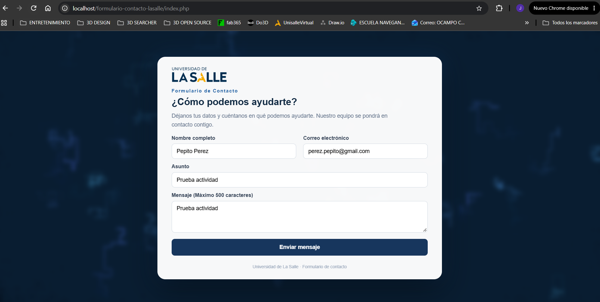
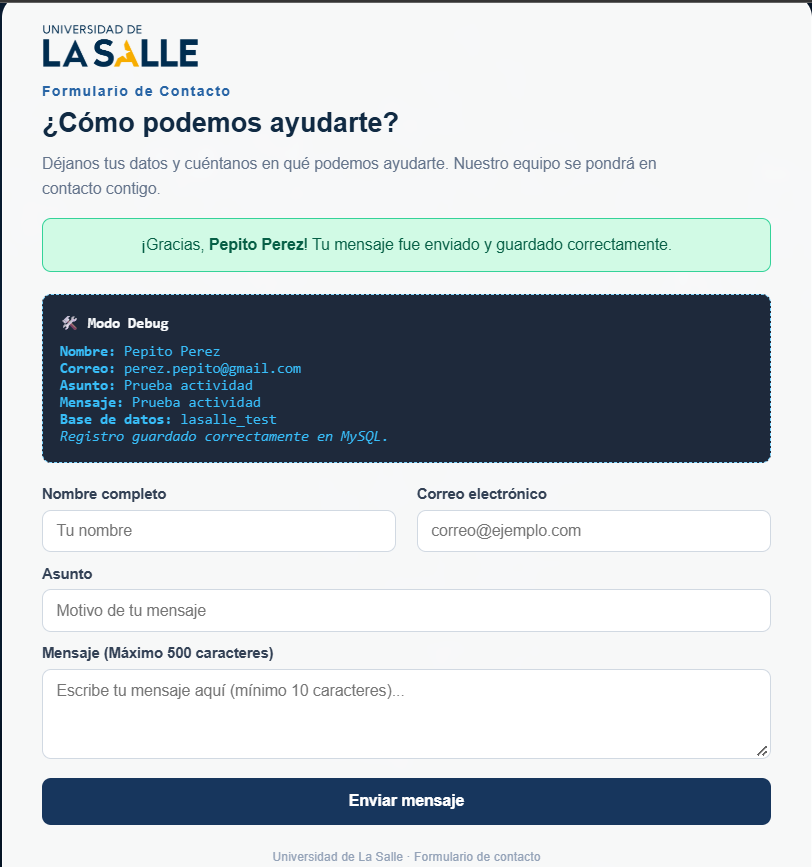
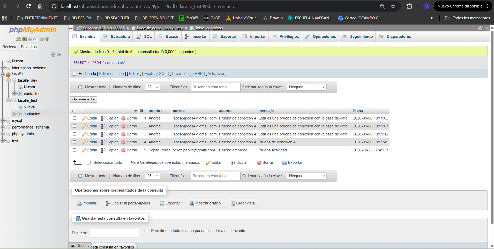
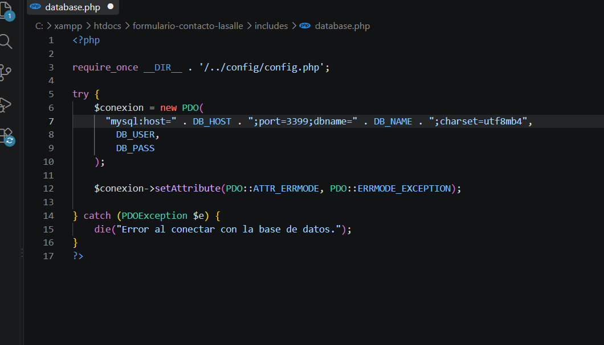
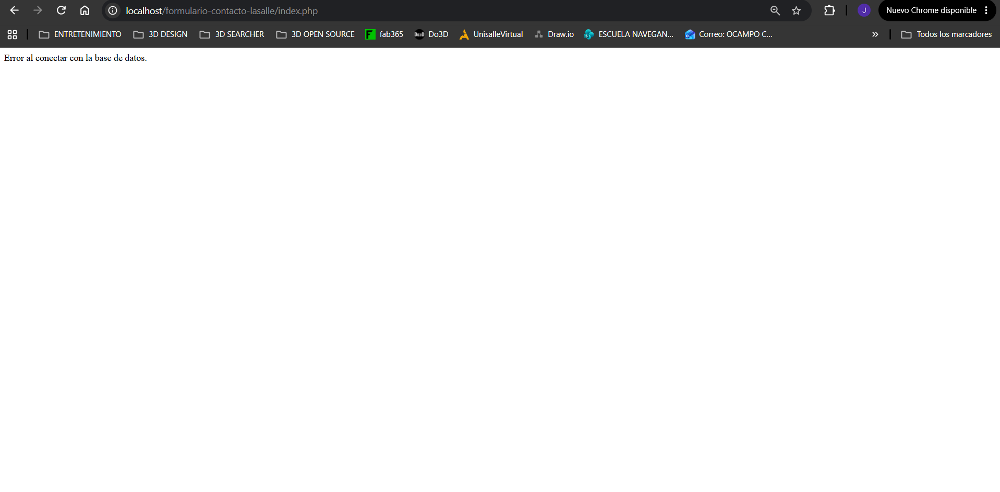
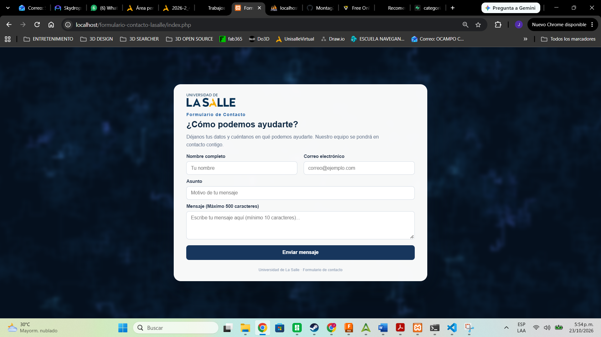

# Actividad 8 - Pruebas de integración

**Aplicación:** Formulario de contacto La Salle  
**Responsable:** Jaime Ocampo  
**Fecha de ejecución:** 23 de octubre de 2026  
**Estado:** Pruebas ejecutadas

## 1. Descripción

El formulario de contacto La Salle permite registrar el nombre,
correo electrónico, asunto y mensaje de un usuario.

Para esta actividad se realizaron pruebas de integración con el
fin de comprobar la comunicación entre el formulario web,
el procesamiento en PHP y la base de datos MySQL.

## 2. Ambiente de pruebas

- Sistema operativo: Windows
- Servidor local: XAMPP
- Servidor web: Apache
- Lenguaje: PHP 8.0.30
- Motor de base de datos: MariaDB 10.4.32
- Puerto de base de datos: 3307
- Base de datos: lasalle_test
- Tabla: contactos
- Navegador: Google Chrome

## 3. Justificación de las pruebas de integración

Se seleccionaron las pruebas de integración porque permiten
verificar que los componentes del formulario funcionan
correctamente cuando se comunican entre sí.

El principal riesgo es que el formulario valide o reciba
información, pero no consiga almacenarla en la base de datos.

También se revisó el comportamiento de la aplicación cuando
se presenta un problema de conexión con MySQL.

---

## 4. Caso INT-01: Registro correcto de un contacto

**Identificador:** INT-01

**Nombre:** Envío y almacenamiento de un contacto.

**Objetivo:**
Comprobar que los datos enviados desde el formulario se
procesen mediante PHP y se almacenen correctamente en MySQL.

**Requisito o componente relacionado:**
Integración entre index.php, database.php y la tabla contactos.

**Precondiciones:**
- Apache y MySQL deben estar funcionando.
- El servidor MySQL debe utilizar el puerto 3307.
- La base de datos lasalle_test debe estar disponible.
- La tabla contactos debe existir.
- El formulario debe cargar correctamente.

**Datos de entrada:**
- Nombre: Pepito Perez
- Correo: perez.pepito@gmail.com
- Asunto: Prueba actividad
- Mensaje: Prueba actividad

**Pasos de ejecución:**
1. Abrir el formulario de contacto La Salle.
2. Diligenciar los campos con los datos de prueba.
3. Presionar el botón "Enviar mensaje".
4. Revisar el mensaje presentado por la aplicación.
5. Abrir phpMyAdmin.
6. Seleccionar la base de datos lasalle_test.
7. Consultar la tabla contactos.
8. Verificar la existencia del nuevo registro.

**Resultado esperado:**
La aplicación debe mostrar una confirmación de envío y
guardar los datos del contacto en la tabla contactos.

**Resultado obtenido:**
El formulario mostró un mensaje indicando que la información
fue enviada y guardada correctamente.

En phpMyAdmin se verificó que la tabla pasó de cuatro a
cinco registros. El nuevo contacto quedó almacenado con
el identificador 5 y los datos ingresados.

**Estado:** APROBADO.

**Evidencias:**

Formulario diligenciado:

Mensaje de confirmación:

Registro almacenado en MySQL:

---

## 5. Caso INT-02: Fallo controlado de conexión con MySQL

**Identificador:** INT-02

**Nombre:** Manejo de error de conexión con la base de datos.

**Objetivo:**
Verificar que la aplicación detecte una conexión fallida con
MySQL y presente un mensaje de error controlado.

**Requisito o componente relacionado:**
Archivo includes/database.php y conexión PDO con MySQL.

**Precondiciones:**
- El formulario debe funcionar inicialmente.
- MySQL debe encontrarse activo en el puerto 3307.
- Debe existir una copia de seguridad del archivo de conexión.

**Datos de entrada:**
- Puerto correcto: 3307.
- Puerto incorrecto utilizado para la prueba: 3399.

**Pasos de ejecución:**
1. Abrir el archivo includes/database.php.
2. Cambiar temporalmente el puerto 3307 por 3399.
3. Guardar el archivo.
4. Actualizar la página del formulario.
5. Observar y registrar el mensaje mostrado.
6. Restaurar el puerto correcto 3307.
7. Guardar nuevamente el archivo.
8. Actualizar el formulario y comprobar su funcionamiento.

**Resultado esperado:**
La aplicación debe detectar que no puede conectarse con
MySQL y mostrar un mensaje comprensible, sin revelar
contraseñas ni detalles técnicos internos.

Después de restaurar la configuración, el formulario debe
volver a cargar normalmente.

**Resultado obtenido:**
Al configurar el puerto 3399, el navegador mostró el mensaje:
"Error al conectar con la base de datos".

No se mostraron credenciales ni detalles internos de la conexión.

Después de restaurar el puerto 3307, el formulario volvió
a cargar correctamente.

**Estado:** APROBADO.

**Evidencias:**

Configuración de puerto incorrecto:

Mensaje de error controlado:

Restablecimiento del formulario:

---

## 6. Defecto identificado y acción correctiva

Durante la preparación del ambiente de pruebas se encontró
que el formulario no conseguía conectarse con la base de datos.

**Causa identificada:**
La conexión PDO no tenía especificado el puerto 3307,
que era el utilizado por MySQL en el ambiente local.

**Corrección aplicada:**
Se ajustó la cadena de conexión del archivo database.php
para incluir el puerto 3307.

**Nueva ejecución:**
Después de aplicar la corrección, el formulario cargó
correctamente y se pudo realizar la prueba INT-01.

Este hallazgo demuestra la importancia de revisar la
configuración de conexión entre los componentes de una
aplicación web.

## 7. Resumen de resultados

| ID | Prueba | Resultado | Estado |
|---|---|---|---|
| INT-01 | Registro de contacto en MySQL | Registro ID 5 almacenado | Aprobado |
| INT-02 | Fallo controlado de conexión | Error controlado y recuperación | Aprobado |

**Total de casos diseñados:** 2

**Total de casos ejecutados:** 2

**Casos aprobados:** 2

**Casos fallidos:** 0

## 8. Conclusiones

Las pruebas permitieron comprobar que el formulario
puede registrar información correctamente en MySQL
cuando los componentes están configurados.

También se verificó que la aplicación presenta un
mensaje controlado ante un fallo de conexión.

Durante la preparación se identificó y corrigió un
problema de configuración del puerto MySQL.

Las evidencias obtenidas permiten comparar los resultados
esperados con los observados durante la ejecución.

## 9. Participación

**Jaime Ocampo:** diseño, ejecución y documentación de
las dos pruebas de integración; verificación de la conexión
PHP-MySQL y recopilación de evidencias.